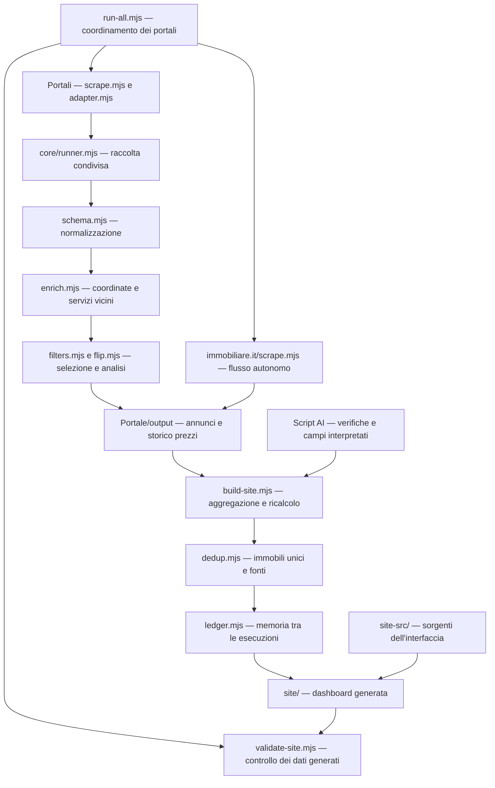

# Mappa del progetto — Radar immobiliare

Mappa ricavata dal codice presente nel repository il 23 novembre 2026. Le categorie dei portali descrivono la configurazione degli script: non attestano la loro accessibilità in tempo reale.

## Scopo e tecnologie

Il progetto raccoglie annunci da più portali per individuare opportunità immobiliari a **Bologna, Pianoro e San Lazzaro di Savena**. Normalizza i dati, applica i profili di ricerca **BIG/SMA**, analizza opportunità di ristrutturazione (**RENO**) e segnali di permanenza sul mercato (**STALE**), quindi genera una dashboard globale deduplicata.

È un progetto **Node.js con moduli JavaScript ESM** (`.mjs`), con **Playwright** per la raccolta e un'interfaccia in **HTML, CSS e JavaScript**. I dati persistono in file JSON; la dashboard generata può essere aperta direttamente da `site/index.html`, senza server.

## Mappa dei flussi



Il diagramma sintetizza il flusso principale. Durante la raccolta il runner salva anche risultati intermedi e riapplica filtri e analisi; il build li ricalcola sui dati disponibili. Gli script AI sono passaggi separati, non vengono eseguiti automaticamente da `run-all.mjs`.

## Struttura del repository

```text
resget/
├── run-all.mjs               Coordinamento della raccolta e della generazione
├── build-site.mjs            Aggregazione, deduplica, memoria e sito globale
├── validate-site.mjs         Ispezione dei dati della dashboard generata
├── login-all.mjs             Gestione dei login per i profili Playwright
├── core/                     Motore condiviso e configurazioni
├── <portale>/                Integrazione di una singola fonte
│   ├── adapter.mjs           Navigazione ed estrazione specifiche del portale
│   ├── scrape.mjs            Avvio della raccolta con il runner condiviso
│   ├── strategia.md          Evidenze, filtri, limiti e scelte operative
│   ├── output/               Annunci, storico prezzi, riepiloghi e fallimenti
│   └── profile/              Profilo browser persistente
├── immobiliare.it/           Scraper autonomo e componenti storici dedicati
├── site-src/                 Sorgenti della dashboard globale
├── site/                     Dashboard generata, esclusa da Git
├── probe-archive/            Evidenze delle ricognizioni dei portali
├── logs/                     Log e rapporti delle esecuzioni
├── ai-residui.mjs            Interpretazione AI dei campi ambigui residui
├── ai-lead-privati.mjs       Verifica AI del venditore dei lead da affitto
├── geocode-deep.mjs          Recupero delle coordinate sui dati già raccolti
├── sanitize-dati.mjs         Correzione dei dati e riapplicazione delle regole
├── test-*.mjs                Verifiche di regressione per i diversi moduli
├── DECISIONI.md              Decisioni architetturali e diario operativo
└── .github/                  Istruzioni operative per gli agenti
```

La struttura `<portale>/` è un modello comune, non uniforme: alcune fonti differite hanno soltanto documentazione; `immobiliare.it/` mantiene un'implementazione propria.

## Punti di ingresso

| File | Responsabilità |
| --- | --- |
| [package.json](package.json) | Definisce dipendenze e comandi npm; il nome del pacchetto è `radar-flip`. |
| [run-all.mjs](run-all.mjs) | Avvia gli scraper, con parallelismo predefinito 8; gestisce selezione dei portali, ripresa, cooldown e log; alla fine genera e valida il sito. |
| [build-site.mjs](build-site.mjs) | Legge l'ultimo `annunci-*.json` di ogni fonte configurata, applica registri AI e verifiche dei lead, ricalcola i profili, deduplica e aggiorna il ledger. Produce `site/data.js` e copia i sorgenti dell'interfaccia. |
| [login-all.mjs](login-all.mjs) | Coordina il login nei profili persistenti usati dalla raccolta, secondo il registro di autenticazione. |
| [validate-site.mjs](validate-site.mjs) | Carica `site/data.js` e stampa conteggi e controlli di integrità dei dati generati. |

## Motore condiviso: `core/`

| Modulo | Descrizione |
| --- | --- |
| [runner.mjs](core/runner.mjs) | Esegue gli adattatori: raccolta delle liste, dettagli, normalizzazione, arricchimento, filtri, analisi, salvataggi incrementali, ripresa e coda dei fallimenti. |
| [schema.mjs](core/schema.mjs) | Definisce lo schema comune degli annunci e normalizza campi, zona, stato, camere e riferimenti alle planimetrie. |
| [filters.mjs](core/filters.mjs) | Applica BIG/SMA e le esclusioni per prezzo, uso, contratto, stato, piano e posizione; individua anche i lead da affitto privato. |
| [geo.mjs](core/geo.mjs) | Definisce comuni ammessi, zone escluse e centri abitati; calcola distanze e riconosce incongruenze geografiche. |
| [enrich.mjs](core/enrich.mjs) | Recupera coordinate da indirizzi e località, dichiara la fonte del geocoding e aggiunge i punteggi dei servizi vicini. |
| [frazione-centri.mjs](core/frazione-centri.mjs) | Gestisce i nomi delle frazioni e la cache dei loro centri verificati. |
| [verify-frazioni.mjs](core/verify-frazioni.mjs) | Popola la cache delle frazioni interrogando Nominatim e controllando i risultati. |
| [geocode-nominatim.mjs](core/geocode-nominatim.mjs) | Utility CLI di geocoding su un file di annunci; il runner condiviso usa invece le funzioni di `enrich.mjs`. |
| [poi.mjs](core/poi.mjs) | Recupera i punti di interesse da Overpass/OpenStreetMap, mantiene la cache e calcola vicinanza e punteggio dei servizi. |
| [poi-config.mjs](core/poi-config.mjs) | Contiene categorie dei servizi, distanze, area geografica e soglie del punteggio POI. |
| [flip.mjs](core/flip.mjs) | Calcola comparabili e mediane, analisi RENO/STALE e storico dei prezzi; esclude aste e affitti dai comparabili standard. |
| [flip-config.mjs](core/flip-config.mjs) | Raccoglie i parametri economici e le soglie dell'analisi flip. |
| [dedup.mjs](core/dedup.mjs) | Raggruppa gli annunci dello stesso immobile usando origini e somiglianze; sceglie la fonte preferita conservando i collegamenti alle altre. |
| [ledger.mjs](core/ledger.mjs) | Mantiene identità dei gruppi tra esecuzioni, prime e ultime osservazioni, prezzi, ribassi, sparizioni, riapparizioni e ripubblicazioni. |
| [verify-source.mjs](core/verify-source.mjs) | Verifica sui portali originari gli annunci provenienti da aggregatori e registra l'esito. |
| [human.mjs](core/human.mjs) | Gestisce browser Playwright, profili persistenti, pause, cookie, navigazione e rilevamento dei blocchi. |
| [health.mjs](core/health.mjs) | Registra blocchi e successi; applica un cooldown fisso di 24 ore ai portali bloccati. |
| [auth-registry.mjs](core/auth-registry.mjs) | Descrive i portali e i flussi di autenticazione utilizzati da `login-all.mjs`. |
| [browser-probe.mjs](core/browser-probe.mjs) | Fornisce funzioni di ispezione della pagina, estrazione dei link e sintesi delle evidenze. |
| [probe-save.mjs](core/probe-save.mjs) | Valida e archivia le evidenze di ricognizione per portale e fase. |
| [probe-verify.mjs](core/probe-verify.mjs) | Verifica le asserzioni `probeChecks` degli adattatori, da archivio oppure dal vivo. |
| [ai.mjs](core/ai.mjs) | Esegue richieste AI con prompt mirati, risposte JSON, cache, soglie di confidenza e limite di chiamate. |
| [ai-config.mjs](core/ai-config.mjs) | Risolve provider, modello e configurazione per Token Plan, DeepSeek oppure Ollama. |

## Portali e adattatori

Il runner elenca **34 portali predefiniti**; il build configura **35 fonti**, includendo Casa.it. Un portale può essere saltato per cooldown o assenza di dati. Gli elenchi da aggiornare per un'integrazione sono `PORTALS` in `run-all.mjs`, `ACTIVE` in `build-site.mjs` e `SOURCE_PRIORITY` in `core/dedup.mjs`.

| Gruppo | Cartelle | Ruolo |
| --- | --- | --- |
| Implementazione autonoma | `immobiliare.it/` | Scraper storico con filtri e moduli propri, alcuni import dal core, build e interfaccia single-portal. L'output confluisce anche nella dashboard globale con ID `immobiliare`. |
| Portali di annunci | `idealista/`, `wikicasa/`, `subito/`, `attico/` | Integrazioni specifiche delle liste e delle schede immobiliari. |
| Aggregatori e ricerca | `flatsearch/`, `trovacasa/`, `mitula/`, `trovit/`, `caasa/` | Raccolta da fonti che possono riproporre annunci di altri portali; tracciamento delle origini e deduplica sono particolarmente rilevanti. |
| Fonti con annunci privati | `bakeca/`, `casadaprivato/` | Raccolta di annunci potenzialmente pubblicati direttamente dal proprietario. Il tipo di venditore va verificato sul singolo annuncio. |
| Reti di agenzie | `tecnocasa/`, `tecnorete/`, `tempocasa/`, `remax/` | Adattatori per le rispettive reti immobiliari. |
| Agenzie locali e affiliate | `gabetti/`, `toscano/`, `professionecasa/`, `grimaldi/`, `livingin/`, `mondore/`, `immobiliaresanlazzaro/`, `grandicase/`, `vivacasa/`, `reportimmobiliare/`, `ars/`, `kapitalre/`, `limmobiliare/`, `giacopini/`, `abitarebologna/`, `millecase/`, `cavallo/`, `alfaeomega/` | Diciotto integrazioni per i siti proprietari delle agenzie, con filtri e selettori specifici documentati nelle rispettive `strategia.md`. |
| Attivazione esplicita | `casait/` | Adattatore presente e fonte inclusa nel build; escluso dalla raccolta predefinita per blocchi persistenti documentati. Selezionabile con `--only casait`. |
| Fonti differite | `casaclick/`, `facebook/`, `nextdoor/`, `dovalue/`, `intesasanpaolo/`, `prelios/`, `agenziademanio/`, `invimit/` | Mostrate dal build come fonti informative con una motivazione: alias, contenuto non pertinente, assenza di residenziale utile o modello di vendita differente. La presenza della cartella non implica raccolta attiva. |

Il contratto tipico di un adattatore comprende `id`, `name`, `collectListings(page, opts)` e `scrapeDetail(page, card, opts)`. Può aggiungere `pace` e `probeChecks`. Un esempio compatto del collegamento al runner è [wikicasa/scrape.mjs](wikicasa/scrape.mjs); i dettagli della fonte sono in [wikicasa/adapter.mjs](wikicasa/adapter.mjs).

## Dashboard e dati persistenti

| Percorso | Contenuto e utilizzo |
| --- | --- |
| [site-src/index.html](site-src/index.html) | Struttura della dashboard globale. |
| [site-src/app.js](site-src/app.js) | Legge `window.RADAR_DATA`: navigazione GLOBAL/per-portale, dashboard, viste BIG/SMA, RENO/STALE, novità, lead privati, dettagli ed esportazione CSV. |
| [site-src/style.css](site-src/style.css) | Aspetto e adattamento dell'interfaccia alle diverse dimensioni dello schermo. |
| `site/data.js` | Dati incorporati dal build; permette di aprire la dashboard da file locale. |
| `<portale>/output/annunci-*.json` | Fotografie dei dati raccolti: il build legge il file più recente per nome. |
| `<portale>/output/prezzi-storico.json` | Storico dei prezzi osservati per la singola fonte. |
| `<portale>/output/falliti-*.json`, `run-summary-*.json` | Coda dei dettagli falliti e riepilogo dell'esecuzione. |
| `ledger.json` | Memoria globale persistente dei gruppi deduplicati. Il build la aggiorna, salvo uso di `--no-ledger`. |
| `ai-residui.json`, `lead-verifiche.json` | Campi interpretati e verifiche del venditore, letti durante il build. |
| `ai-cache.json`, `core/*-cache.json` | Cache delle risposte AI, dei servizi, delle frazioni e delle verifiche delle origini. |
| `core/portal-health.json` | Stato dei blocchi e dei cooldown. |
| `logs/run-*/` | Log per portale e rapporto aggregato `report.json`. |
| `<portale>/profile/` | Sessioni browser locali, escluse da Git. |

Per modificare la dashboard globale si interviene in `site-src/` e si rigenera `site/`. I sorgenti sotto `immobiliare.it/site-src/` appartengono invece alla vista storica del singolo portale. Le esclusioni dei dati locali e della configurazione reale sono definite in [.gitignore](.gitignore); il modello di configurazione AI condivisibile è [ai-config.example.json](ai-config.example.json).

## Regole e passaggi complementari

I profili correnti sono definiti in `core/filters.mjs`: BIG ha prezzo massimo 160.000 € e almeno due camere; SMA ha prezzo massimo 130.000 € e una camera. Entrambi hanno superficie minima configurata di 55 m², con regole aggiuntive per i diversi casi. I valori geografici predefiniti sono distanza massima 3 km dai centri di riferimento e punteggio POI minimo 35.

Le esclusioni comprendono, tra le altre, trattativa riservata, aste, affitti nelle selezioni di vendita, nuda proprietà e immobili già ristrutturati o nuovi. Gli affitti privati idonei possono comparire nella vista separata dei lead. Gli esiti dipendono anche dalla verificabilità dei campi: per il dettaglio operativo valgono le funzioni dei filtri e [DECISIONI.md](DECISIONI.md).

| Script | Passaggio complementare |
| --- | --- |
| [ai-residui.mjs](ai-residui.mjs) | Interpreta solo i campi ambigui che possono cambiare l'esito dell'annuncio; registra evidenze e confidenza. |
| [ai-lead-privati.mjs](ai-lead-privati.mjs) | Valuta dalle frasi dell'annuncio se il venditore di un lead è privato o agenzia. |
| [geocode-deep.mjs](geocode-deep.mjs) | Recupera coordinate mancanti sui dati esistenti usando i livelli di geocoding condivisi. |
| [sanitize-dati.mjs](sanitize-dati.mjs) | Corregge campi verificabili dai testi e riapplica le regole ai JSON già raccolti; offre `--dry-run`. |

La raccolta salva risultati parziali quando incontra blocchi. I flussi di ricognizione, verifica degli adattatori e login sono descritti in [.github/copilot-instructions.md](.github/copilot-instructions.md).

## Comandi per orientarsi

Da eseguire nella radice del repository:

| Comando | Effetto |
| --- | --- |
| `npm run radar` | Raccolta predefinita, build e validazione. |
| `npm run radar:resume` | Ripresa dagli ultimi JSON disponibili, poi build e validazione. |
| `npm run radar -- --only wikicasa,subito` | Raccolta limitata ai portali indicati. |
| `npm run radar -- --site-only` | Build e validazione sui dati presenti, senza nuova raccolta. |
| `npm run build` | Generazione della dashboard; aggiorna anche il ledger. |
| `node build-site.mjs --no-ledger --out site-preview` | Generazione separata senza leggere né scrivere la memoria del ledger. |
| `npm run login:check` | Controllo delle sessioni tramite il flusso di login. |
| `npm run probe:save -- --id wikicasa --file <json>` | Archiviazione di una ricognizione. |
| `npm run probe:verify -- --id wikicasa --from-archive` | Verifica delle asserzioni dell'adattatore usando le evidenze archiviate. |

**Disallineamento presente:** `npm run probe` richiama `probe-all.mjs`, che non è presente nella radice analizzata. I comandi `probe:save` e `probe:verify` puntano invece a file esistenti.

## Verifiche esistenti e percorsi di modifica

Le verifiche sono script Node separati: `test-qualita-dati.mjs` per filtri e qualità, `test-superficie.mjs` per le superfici, `test-dedup-origine.mjs` per deduplica e fonti, `test-ledger.mjs` per la memoria, `test-health.mjs` per cooldown, `test-browser-probe.mjs` per le ricognizioni e `test-ai.mjs` per le funzioni AI offline. `validate-site.mjs` richiede invece il sito già generato. Non è definito uno script npm `test`.

| Modifica desiderata | Da dove iniziare |
| --- | --- |
| Cambiare criteri di selezione | `core/filters.mjs`, `core/geo.mjs`, `core/poi-config.mjs`; controllare anche il flusso autonomo di `immobiliare.it/`. |
| Cambiare costi e soglie delle analisi | `core/flip-config.mjs` e `core/flip.mjs`. |
| Correggere l'estrazione di una fonte | `<portale>/adapter.mjs`, le sue `probeChecks` e `<portale>/strategia.md`. |
| Aggiungere un portale | Contratto dell'adattatore e registri in `run-all.mjs`, `build-site.mjs`, `core/dedup.mjs`; registro autenticazione se necessario. |
| Correggere raggruppamenti o continuità storica | `core/dedup.mjs` e `core/ledger.mjs`. |
| Modificare viste, colonne o CSV | `site-src/app.js`, con struttura e stile negli altri file di `site-src/`. |
| Cambiare modello o interpretazione AI | `core/ai-config.mjs`, `core/ai.mjs` e lo script AI relativo al compito. |

I requisiti storici sono in [immobiliare.it/requisiti-immobilare.md](immobiliare.it/requisiti-immobilare.md); le decisioni trasversali e le successive evoluzioni sono in [DECISIONI.md](DECISIONI.md). Dove la documentazione storica riporta percorsi o conteggi precedenti, questa mappa usa la struttura e i registri del codice attuale.
